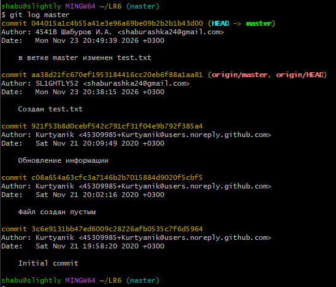
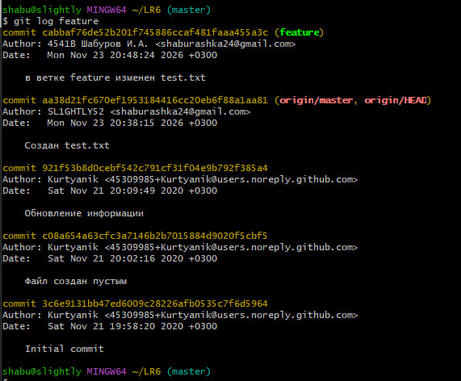
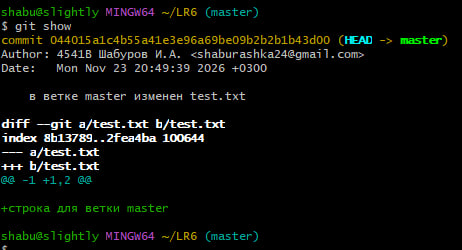
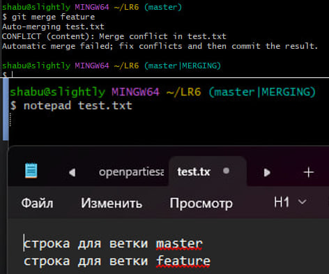
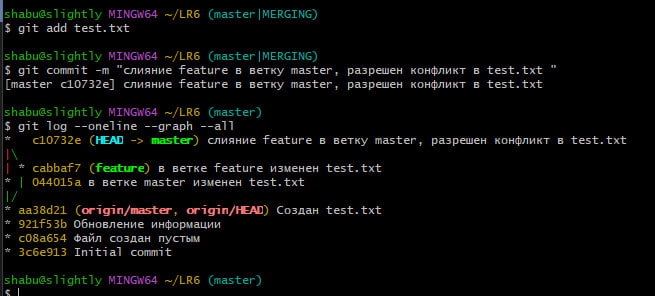
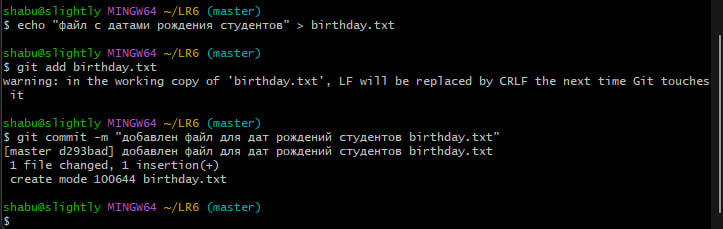
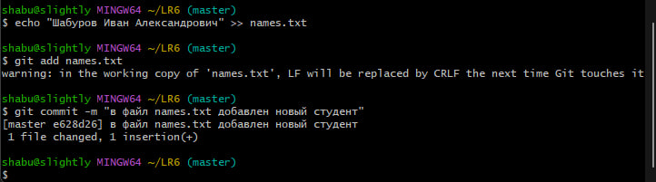

# Лабораторная работа №6
## Система контроля версий
**Выполнил:** 4541в Шабуров И.А.

## Ход работы
### 1. Настройка Git

### 2. Клонирование репозитория

### 3. Подтягивание изменений

### 4. История веток

### 5. Последние изменения

### 6. Слияние с разрешением конфликта

### 7. Удаление побочной ветки

### 8. Создание коммитов

### 9. Откат коммита

### 10. Ветка для отчета
