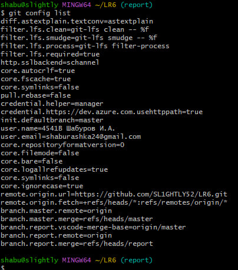
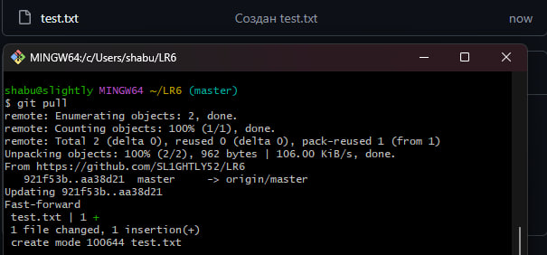
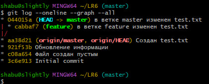
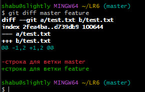
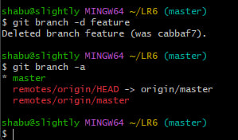
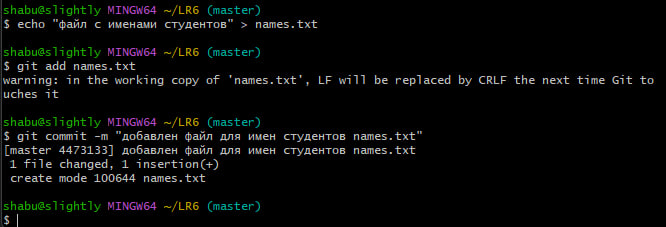
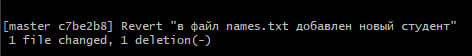
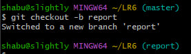
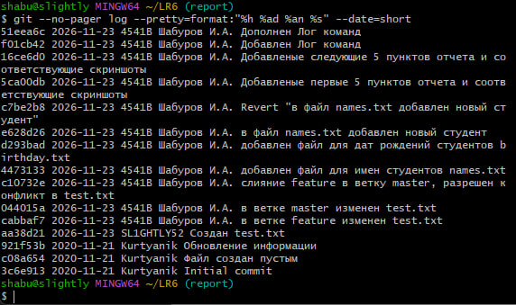

# Лабораторная работа №6
## Система контроля версий
**Выполнил:** 4541в Шабуров И.А.

## Ход работы
### 1. Настройка Git


### 2. Клонирование репозитория

### 3. Подтягивание изменений


### 4. История веток




### 5. Последние изменения



### 6. Слияние с разрешением конфликта


### 7. Удаление побочной ветки


### 8. Создание коммитов



### 9. Откат коммита


### 10. Ветка для отчета


## Лог команд
```bash
git config --global user.name "4541В Шабуров И.А."
git config --global user.email "shaburashka24@gmail.com"
git config --list
git clone https://github.com/SL1GHTLY52/LR6.git
cd LR6
git pull
git branch -a
git log master
git checkout -b feature
echo "строка для ветки feature" >> test.txt
git add test.txt
git commit -m "в ветке feature изменен test.txt"
git checkout master
echo "строка для ветки master" >> test.txt
git add test.txt
git commit -m "в ветке master изменен test.txt"
git log master
git log feature
git log --oneline --graph --all
git show
git diff master feature
git checkout master
git merge feature
git mergetool test.txt
notepad test.txt
git add test.txt
git commit -m "слияние feature в ветку master, разрешен конфликт в test.txt"
git log --oneline --graph --all
git branch -d feature
git branch -a
echo "файл с именами студентов" > names.txt
git add names.txt
git commit -m "добавлен файл для имен студентов names.txt"
echo "файл с датами рождения студентов" > birthday.txt
git add birthday.txt
git commit -m "добавлен файл для дат рождений студентов birthday.txt"
echo "Шабуров Иван Александрович" >> names.txt
git add names.txt
git commit -m "в файл names.txt добавлен новый студент"
git log --oneline
git revert HEAD
git checkout -b report
mkdir screenshots
cp "/e/фото лабы"/* screenshots/
git status
git add README.md screenshots/
git commit -m "Добавленые первые 5 пунктов отчета и соответствующие скриншоты"
пше ыефегы
git status
cp "/e/фото лабы"/* screenshots/
git add README.md screenshots/
git commit -m "Добавленые следующие 5 пунктов отчета и соответствующие скриншоты"
git status
git add README.md
git commit -m "Добавлен Лог команд"
```

## История коммитов



```bash
$ git --no-pager log --pretty=format:"%h %ad %an %s" --date=short
51eea6c 2026-11-23 4541В Шабуров И.А. Дополнен Лог команд
f01cb42 2026-11-23 4541В Шабуров И.А. Добавлен Лог команд
16ce6d0 2026-11-23 4541В Шабуров И.А. Добавленые следующие 5 пунктов отчета и соответствующие скриншоты
5ca00db 2026-11-23 4541В Шабуров И.А. Добавленые первые 5 пунктов отчета и соответствующие скриншоты
c7be2b8 2026-11-23 4541В Шабуров И.А. Revert "в файл names.txt добавлен новый студент"
e628d26 2026-11-23 4541В Шабуров И.А. в файл names.txt добавлен новый студент
d293bad 2026-11-23 4541В Шабуров И.А. добавлен файл для дат рождений студентов birthday.txt
4473133 2026-11-23 4541В Шабуров И.А. добавлен файл для имен студентов names.txt
c10732e 2026-11-23 4541В Шабуров И.А. слияние feature в ветку master, разрешен конфликт в test.txt
044015a 2026-11-23 4541В Шабуров И.А. в ветке master изменен test.txt
cabbaf7 2026-11-23 4541В Шабуров И.А. в ветке feature изменен test.txt
aa38d21 2026-11-23 SL1GHTLY52 Создан test.txt
921f53b 2020-11-21 Kurtyanik Обновление информации
c08a654 2020-11-21 Kurtyanik Файл создан пустым
3c6e913 2020-11-21 Kurtyanik Initial commit
```
